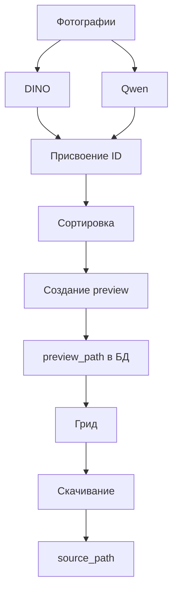

### ✅ **Итоговая архитектура**



---

### 🔧 **Как это работает**

#### 1. **DINO и Qwen**
- **DINO** работает с `source_path` из БД.
- **Qwen** работает с тем же `source_path`, но только для `qwen_status = 'pending'`.
- Оба процесса **параллельны**, не зависят от друг друга.

#### 2. **Присвоение ID**
- После обработки DINO/Qwen фотография получает:
  - `address`
  - `client`
  - `id`
- Записывается в `photos`.

#### 3. **Сортировка**
- Фотографии группируются по `address` и `client`.
- Путь к файлу: `source_path`.

#### 4. **Создание preview**
- После сортировки генерируется превью.
- Путь сохраняется в `preview_path` БД.

#### 5. **Грид**
- Использует `preview_path` из БД.
- Если `preview_path` пуст — показывает `source_path`.
- Не зависит от `output/daily`.

#### 6. **Скачивание**
- Использует `source_path` и `original_filename`.
- Формат: `АДРЕС_оригинальное_имя.JPG`.

---

### 🛠️ **Как это реализовать**

#### 1. **DINO**
- Уже работает с `source_path` из БД.
- Нет изменений.

#### 2. **Qwen**
- Изменить логику: вместо `input/daily` использовать `source_path` из БД.
- Пример:
  ```python
  qwen_photos = db.query("SELECT * FROM photos WHERE qwen_status = 'pending'")
  ```

#### 3. **Сортировка**
- Использовать `address` и `client` из БД.
- Пример:
  ```python
  sorted_photos = db.query("SELECT * FROM photos ORDER BY address, client")
  ```

#### 4. **Создание preview**
- Генерировать превью и записывать в `preview_path`.
- Пример:
  ```python
  preview_path = generate_preview(source_path)
  db.update("UPDATE photos SET preview_path = %s WHERE id = %s", (preview_path, photo_id))
  ```

#### 5. **Грид**
- Использовать `preview_path` из БД.
- Пример:
  ```python
  for photo in db.query("SELECT * FROM photos"):
      if photo.preview_path:
          show_preview(photo.preview_path)
      else:
          show_original(photo.source_path)
  ```

#### 6. **Скачивание**
- Использовать `source_path` и `original_filename`.
- Пример:
  ```python
  filename = photo.original_filename or Path(photo.source_path).name
  download_path = f"{photo.address}_{filename}"
  ```

---

### 📌 **Важные моменты**

1. **БД как источник истины**
   - Все операции (DINO, Qwen, сортировка, превью, грид) работают с БД.
   - Физические пути (`source_path`, `preview_path`) — это просто ссылки на файлы.

2. **Грид не зависит от структуры папок**
   - Грид работает только с БД.
   - Физическая структура (например, `output/daily`) не влияет на отображение.

3. **Скачивание**
   - Использует `source_path` и `original_filename` для уникальности имен.
   - Формат: `АДРЕС_оригинальное_имя.JPG`.

4. **Параллельность**
   - DINO и Qwen работают параллельно, не блокируя друг друга.
   - Сортировка и превью запускаются после обработки DINO/Qwen.

---

### 🧪 **Проверка**

1. **Проверить данные в БД**
   - Убедиться, что `source_path`, `original_filename`, `preview_path` заполнены.
   - Пример:
     ```sql
     SELECT source_path, original_filename, preview_path FROM photos LIMIT 5;
     ```

2. **Проверить грид**
   - Убедиться, что грид использует `preview_path` из БД.
   - Если `preview_path` пуст — показывать `source_path`.

3. **Проверить скачивание**
   - Убедиться, что скачивается файл из `source_path` с именем `АДРЕС_оригинальное_имя.JPG`.

---

### 🚀 **Итог**

- **DINO и Qwen** работают с БД, не зависят друг от друга.
- **Сортировка и превью** запускаются после обработки DINO/Qwen.
- **Грид** работает только с БД, не зависит от структуры папок.
- **Скачивание** использует `source_path` и `original_filename` для уникальности имен.

Эта архитектура обеспечивает гибкость, надежность и масштабируемость системы.