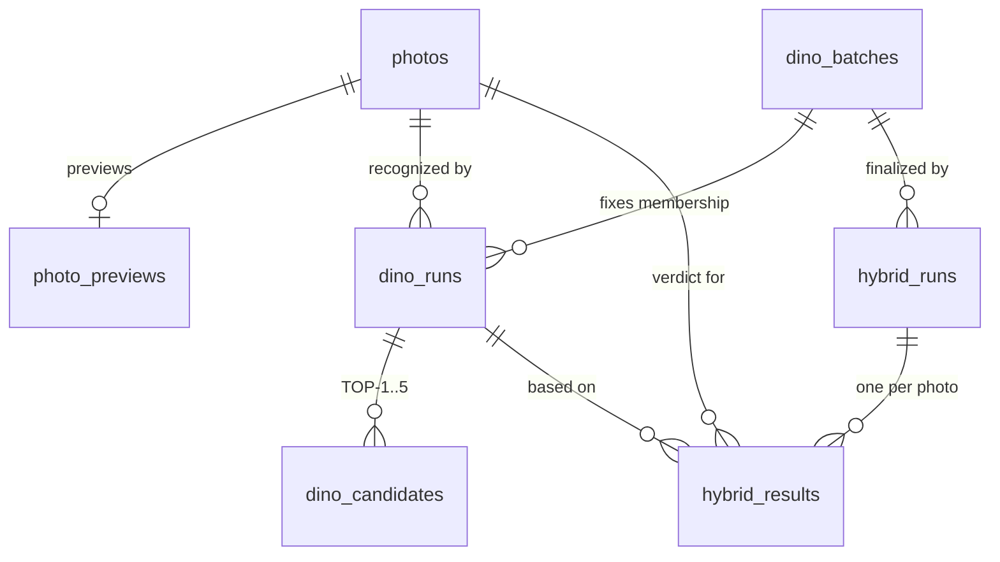

# Структура базы данных Scene Fingerprint / PhotoBAse

**Источник:** выведено из SQL-схем `schema/001_ingest.sql` … `schema/005_hybrid.sql` и из фактических чтений/записей в `app/ingest/database.py`, `app/preview/database.py`, `app/dino/database.py`, `app/hybrid/database.py`, а также из локальной SQLite-очереди `app/pipeline/queue.py`.

**Статус:** описание текущего контракта репозитория. Ни к какой живой БД это не применялось и на живой БД не проверялось.

**Важно про `111/chatgpt_md`:** архив описывает **другую, legacy-схему** (`dbname=photobase`, `user=lora`, широкая таблица `photos` с колонками `address/client/brand/category/qwen_status/...`). Она **не совпадает** с текущим контрактом и нормой не является. Ниже — только то, что реально читает/пишет текущий код.

## 1. Общая картина

Два независимых хранилища:

| Хранилище | Назначение | Где создаётся |
|---|---|---|
| PostgreSQL | физическая идентичность фото, preview, DINO/HYBRID результаты | `schema/001…005.sql` |
| SQLite (`data/jobs.db`) | очередь заданий создания эталонных fingerprint-слепков | `app/pipeline/queue.py` |

PostgreSQL — источник истины для переходов между этапами DINO → HYBRID → PREVIEW. Слепки (FAISS-артефакты) живут на диске в `data/fingerprints/<id>`, а не в БД.

## 2. Порядок применения схем

Схемы применяются строго по порядку (внутренних зависимостей нет, но `004` опирается на таблицы из `003`):

```
001_ingest.sql   → photos
002_preview.sql  → photo_previews         (FK → photos)
003_dino.sql     → dino_runs, dino_candidates
004_dino_batches.sql → dino_batches, ALTER dino_runs ADD batch_id
005_hybrid.sql   → hybrid_runs, hybrid_results
006_job_queue.sql → job_queue
007_qwen.sql      → photo_qwen; ALTER job_queue ADD QWEN_PHOTO
```

**`004` теперь backfill-safe и идемпотентен (2026-10-12):** создаёт `dino_batches` при отсутствии, добавляет `dino_runs.batch_id` (nullable) при отсутствии, бэкфиллит существующие runs без batch (по одному legacy-batch на run, со статусом и счётчиками из run), затем ставит `NOT NULL` и создаёт индекс. Повторный прогон — no-op. Ранее файл делал `ADD COLUMN` и сразу `SET NOT NULL`, что падало на непустой `dino_runs`.

**Остальные файлы (001–003, 005) не идемпотентны:** `CREATE TABLE` без `IF NOT EXISTS`; повторный прогон на существующей БД упадёт. Миграционного раннера в проекте нет.

**Repair для старых данных:** если по БД ранее работал старый `finish_batch` (до 2026-10-12) и могли остаться batch со статусом `DONE` при наличии `FAILED` runs, есть `scripts/repair_dino_batch_status.sql` (идемпотентный: переводит такие batch в `FAILED` и пересчитывает счётчики).

**Search path:** почти весь код пишет в `public.` явно (`app/ingest`, `app/dino`, `app/hybrid`). Исключение — `app/preview/database.py`, где таблица `photo_previews` указана **без схемы** (зависит от `search_path`). Косметическое, но стоит унифицировать.

## 3. ER-диаграмма



## 4. Таблицы

### 4.1 `photos` — физическая идентичность (INGEST)

Создаёт `schema/001_ingest.sql`; пишет только `app/ingest/database.py` (`insert_photos` / `insert_photo`), проверяет `check_identity_batch` (NEW/EXISTING/CONFLICT).

| Колонка | Тип | Ограничения |
|---|---|---|
| `photo_id` | TEXT | PRIMARY KEY |
| `source_path` | TEXT | NOT NULL |
| `filename` | TEXT | NOT NULL |
| `sha256` | CHAR(64) | NOT NULL UNIQUE |
| `container_format` | TEXT | NOT NULL (`JPEG`/`MPO`) |
| `frame_count` | INTEGER | NOT NULL |
| `width` | INTEGER | NOT NULL |
| `height` | INTEGER | NOT NULL |
| `created_at` | TIMESTAMP | NOT NULL DEFAULT CURRENT_TIMESTAMP |

`photo_id = PH_ + первые 24 hex SHA-256`. `sha256 UNIQUE` гарантирует одну строку на физический файл.

### 4.2 `photo_previews` — производные превью (PREVIEW)

Создаёт `schema/002_preview.sql`; пишет `app/preview/database.py:upsert_preview` (только когда оба превью валидны), читает `get_preview`.

| Колонка | Тип | Ограничения |
|---|---|---|
| `photo_id` | TEXT | PRIMARY KEY, FK → `photos(photo_id)` ON DELETE CASCADE |
| `small_path` | TEXT | NOT NULL |
| `middle_path` | TEXT | NOT NULL |
| `small_width` / `small_height` | INTEGER | NOT NULL |
| `middle_width` / `middle_height` | INTEGER | NOT NULL |
| `small_created_at` | TIMESTAMP | NOT NULL DEFAULT CURRENT_TIMESTAMP |
| `middle_created_at` | TIMESTAMP | NOT NULL DEFAULT CURRENT_TIMESTAMP |

Запись невозможна без зарегистрированного `photos`. `ON CONFLICT (photo_id) DO UPDATE` дополнительно переставляет `*_created_at = CURRENT_TIMESTAMP`.

### 4.3 `dino_runs` — один прогон DINO на одном фото

Создаёт `schema/003_dino.sql` (+ колонка `batch_id` из `004`); пишет `app/dino/database.py`.

| Колонка | Тип | Ограничения |
|---|---|---|
| `run_id` | BIGSERIAL | PRIMARY KEY |
| `photo_id` | TEXT | NOT NULL, FK → `photos` ON DELETE CASCADE |
| `batch_id` | BIGINT | NOT NULL, FK → `dino_batches(batch_id)` ON DELETE CASCADE (добавлена в `004`) |
| `run_type` | TEXT | NOT NULL, CHECK `NORMAL`/`FORCE_RERUN` |
| `status` | TEXT | NOT NULL, CHECK `PENDING`/`RUNNING`/`DONE`/`FAILED` |
| `dino_best_id` | TEXT | |
| `dino_score` | DOUBLE PRECISION | |
| `dino_second_score` | DOUBLE PRECISION | |
| `dino_margin` | DOUBLE PRECISION | |
| `dino_confidence` | TEXT | `HIGH`/`PROBABLE`/`AMBIGUOUS`/`NO_MATCH` |
| `dino_status` | TEXT | `CONFIDENT`/`PROBABLE_MATCH`/`AMBIGUOUS`/`NO_MATCH` |
| `started_at` / `finished_at` | TIMESTAMP | |
| `dino_time_sec` | DOUBLE PRECISION | длительность |
| `error_message` | TEXT | |
| `created_at` | TIMESTAMP | NOT NULL DEFAULT CURRENT_TIMESTAMP |

Индексы: `idx_dino_runs_photo(photo_id)`; `idx_dino_runs_photo_done(photo_id, finished_at DESC) WHERE status='DONE'`; `idx_dino_runs_batch(batch_id)`.

История сохраняется: один `photo_id` может иметь много runs (NORMAL + FORCE_RERUN). Предыдущие не удаляются.

### 4.4 `dino_candidates` — TOP-1..5 для одного run

Создаёт `schema/003_dino.sql`; пишет `save_success` в одной транзакции с обновлением run.

| Колонка | Тип | Ограничения |
|---|---|---|
| `run_id` | BIGINT | FK → `dino_runs(run_id)` ON DELETE CASCADE |
| `rank` | INTEGER | CHECK 1..5 |
| `fingerprint_id` | TEXT | NOT NULL |
| `score` | DOUBLE PRECISION | NOT NULL |
| `global_score` | DOUBLE PRECISION | NOT NULL |
| `environment_score` | DOUBLE PRECISION | NOT NULL |
| `color_score` | DOUBLE PRECISION | NOT NULL |
| `spatial_score` | DOUBLE PRECISION | NOT NULL |
| `best_image` | TEXT | |
| `best_image_score` | DOUBLE PRECISION | NOT NULL |

PRIMARY KEY `(run_id, rank)`; индекс `idx_dino_candidates_fingerprint(fingerprint_id)`.

### 4.5 `dino_batches` — фиксированный состав прогона

Создаёт `schema/004_dino_batches.sql`; пишет `app/dino/database.py` (`create_batch`, `start_batch`, `finish_batch`).

| Колонка | Тип | Ограничения |
|---|---|---|
| `batch_id` | BIGSERIAL | PRIMARY KEY |
| `run_type` | TEXT | NOT NULL, CHECK `NORMAL`/`FORCE_RERUN` |
| `status` | TEXT | NOT NULL, CHECK `PENDING`/`RUNNING`/`DONE`/`FAILED` |
| `total_count` | INTEGER | NOT NULL, CHECK ≥ 0 |
| `completed_count` | INTEGER | NOT NULL DEFAULT 0, CHECK ≥ 0 |
| `failed_count` | INTEGER | NOT NULL DEFAULT 0, CHECK ≥ 0 |
| `created_at` | TIMESTAMP | NOT NULL DEFAULT CURRENT_TIMESTAMP |
| `started_at` / `finished_at` | TIMESTAMP | |

Состав фиксируется созданием `dino_runs` со `status='PENDING'` на каждое фото. Пустой batch (`total_count=0`) сразу получает `status='DONE'`.

### 4.6 `hybrid_runs` — прогон HYBRID на одном DINO batch

Создаёт `schema/005_hybrid.sql`; пишет `app/hybrid/database.py` (`create_run`, требует `dino_batches.status='DONE'`).

| Колонка | Тип | Ограничения |
|---|---|---|
| `hybrid_run_id` | BIGSERIAL | PRIMARY KEY |
| `dino_batch_id` | BIGINT | NOT NULL, FK → `dino_batches` ON DELETE CASCADE |
| `status` | TEXT | NOT NULL, CHECK `PENDING`/`RUNNING`/`DONE`/`FAILED` |
| `total_count` | INTEGER | NOT NULL, CHECK ≥ 0 |
| `completed_count` | INTEGER | NOT NULL DEFAULT 0, CHECK ≥ 0 |
| `failed_count` | INTEGER | NOT NULL DEFAULT 0, CHECK ≥ 0 |
| `created_at` | TIMESTAMP | NOT NULL DEFAULT CURRENT_TIMESTAMP |
| `started_at` / `finished_at` | TIMESTAMP | |

Один DINO batch может иметь несколько HYBRID runs (повторный прогон = новая строка). Индекс `idx_hybrid_runs_dino_batch`.

### 4.7 `hybrid_results` — вердикт на одно фото

Создаёт `schema/005_hybrid.sql`; пишет `save_success`/`save_failure`.

| Колонка | Тип | Ограничения |
|---|---|---|
| `hybrid_run_id` | BIGINT | FK → `hybrid_runs` ON DELETE CASCADE |
| `photo_id` | TEXT | FK → `photos` ON DELETE CASCADE |
| `dino_run_id` | BIGINT | FK → `dino_runs` ON DELETE CASCADE |
| `hybrid_original_id` | TEXT | DINO-кандидат до HYBRID |
| `hybrid_final_id` | TEXT | итоговый кандидат |
| `hybrid_changed` | BOOLEAN | NOT NULL DEFAULT FALSE |
| `hybrid_old_score` / `hybrid_score` / `hybrid_margin` | DOUBLE PRECISION | |
| `hybrid_neighbors` | TEXT | JSON соседей |
| `status` | TEXT | NOT NULL, CHECK `DONE`/`FAILED` |
| `error_message` | TEXT | |
| `hybrid_time_sec` | DOUBLE PRECISION | |
| `created_at` | TIMESTAMP | NOT NULL DEFAULT CURRENT_TIMESTAMP |
| `finished_at` | TIMESTAMP | |

PRIMARY KEY `(hybrid_run_id, photo_id)`; индексы по `photo_id`, `dino_run_id`, `hybrid_final_id`. `save_*` дополнительно сверяет, что `dino_run_id` принадлежит batch'у этого run и имеет `status='DONE'`.

### 4.8 `job_queue` — отложенные задания обработки

Создаёт `schema/006_job_queue.sql`; пишет `app/jobs/database.py`, читает/исполняет `app/jobs/worker.py`. Введена вместе с web-API: API только ставит задание, тяжёлый inference выполняет отдельный worker-процесс.

| Колонка | Тип | Ограничения |
|---|---|---|
| `id` | BIGSERIAL | PRIMARY KEY |
| `job_type` | TEXT | NOT NULL, CHECK `DINO_BATCH`/`HYBRID_RUN` |
| `payload` | JSONB | NOT NULL DEFAULT `{}` |
| `status` | TEXT | NOT NULL DEFAULT `PENDING`, CHECK `PENDING`/`RUNNING`/`DONE`/`FAILED` |
| `attempts` | INTEGER | NOT NULL DEFAULT 0, CHECK ≥ 0 |
| `result` | JSONB | |
| `error_message` | TEXT | |
| `created_at` | TIMESTAMP | NOT NULL DEFAULT CURRENT_TIMESTAMP |
| `started_at` / `finished_at` | TIMESTAMP | |

Индекс `idx_job_queue_status(status, id)`. Забор задания — `SELECT … FOR UPDATE SKIP LOCKED` + `UPDATE … status='RUNNING'` (атомарно). `payload` для `DINO_BATCH` = `{batch_id}`, для `HYBRID_RUN` = `{hybrid_run_id}`, для `QWEN_PHOTO` = `{photo_id}`.

### 4.9 `photo_qwen` — текстовые метаданные (QWEN)

Создаёт `schema/007_qwen.sql`; пишет `app/qwen` (через worker). Параллельный процесс, независимый от DINO/HYBRID; на идентичность и распознавание не влияет.

| Колонка | Тип | Ограничения |
|---|---|---|
| `photo_id` | TEXT | PRIMARY KEY, FK → `photos` ON DELETE CASCADE |
| `status` | TEXT | NOT NULL DEFAULT `PENDING`, CHECK `PENDING`/`RUNNING`/`DONE`/`FAILED` |
| `description` / `address` / `client` / `brand` / `category` | TEXT | |
| `tags` | JSONB | |
| `raw` | JSONB | полный ответ модели |
| `qwen_model` | TEXT | имя модели |
| `qwen_time_sec` | DOUBLE PRECISION | |
| `error_message` | TEXT | |
| `created_at` / `finished_at` | TIMESTAMP | |

Индексы по `status`, `address`, `client`. `007` также расширяет `job_queue.job_type` значением `QWEN_PHOTO`.

## 5. Локальная SQLite-очередь (не PostgreSQL)

`app/pipeline/queue.py` создаёт `data/jobs.db`, таблица `jobs`:

| Колонка | Тип | Ограничения |
|---|---|---|
| `id` | INTEGER | PRIMARY KEY AUTOINCREMENT |
| `source_folder` | TEXT | NOT NULL |
| `fingerprint_id` | TEXT | NOT NULL |
| `status` | TEXT | NOT NULL DEFAULT `PENDING` (`PENDING`/`PROCESSING`/`DONE`/`FAILED`) |
| `priority` | INTEGER | NOT NULL DEFAULT 0 |
| `attempts` | INTEGER | NOT NULL DEFAULT 0 |
| `created_at` | TEXT | NOT NULL |
| `started_at` / `finished_at` | TEXT | |
| `error` | TEXT | |

Индекс `idx_jobs_status_priority(status, priority DESC, id)`. Забор задания — `BEGIN IMMEDIATE` + `UPDATE … WHERE status='PENDING'` (атомарный claim). Это отдельный от PostgreSQL процесс создания слепков.

## 6. Подключение (env)

Все четыре PostgreSQL-модуля используют один набор переменных:

```
INGEST_DB_HOST      (default localhost)
INGEST_DB_PORT      (default 5432)
INGEST_DB_NAME      (default photobase_ingest_test)
INGEST_DB_USER      (default lora_ingest)
INGEST_DB_PASSWORD  (обязательна; отсутствие → ошибка)
```

Расхождение с архивом: legacy-проект использовал `dbname=photobase`, `user=lora` (и пустой пароль). Текущий код по умолчанию ждёт `photobase_ingest_test` / `lora_ingest` — эти имена подтверждены `docs/ingest.md` §5.

Статус на 2026-10-12: БД `photobase_ingest_test` и роль `lora_ingest` созданы в локальном кластере, применены `schema/001–005` (7 таблиц). Ранее в кластере их не было (были только `albion`, `postgres`, `template*`), то есть проверка из `docs/ingest.md` §5 относилась к более раннему состоянию/окружению. Процедура развёртывания — в [`db_setup.md`](db_setup.md).

## 7. Замечания и расхождения (кандидаты на исправление)

1. ~~**`finish_batch`** ставит `DONE` при наличии `FAILED`~~ **— исправлено (2026-10-12)**: `finish_batch` теперь возвращает `FAILED`, если есть провалы, а `hybrid.database.create_run` дополнительно требует `failed_count == 0`. Покрыто интеграционными тестами (`tests/test_dino_batch_integration.py`).
2. **Миграция `004`**: `SET NOT NULL` без backfill → падение на непустой `dino_runs`.
3. **`photo_previews` без `public.`** в `app/preview/database.py` — единственная не-квалифицированная таблица.
4. **Нет `updated_at`/heartbeat** ни в `dino_runs`, ни в `dino_batches` — нельзя отличить «долго работающий» run от «зависшего».
5. **Схемы не идемпотентны**, миграционного раннера нет: повторное применение падает.
6. `dino_candidates.rank` ограничен 1..5 и код режет `candidates[:5]` — соответствие сохраняется, но лимит зашит в двух местах.

## 8. Связанные материалы

- [`ingest.md`](ingest.md), [`preview.txt`](preview.txt), [`dino.txt`](dino.txt), [`hybrid.txt`](hybrid.txt) — поведение слоёв.
- [`project_assessment.md`](project_assessment.md) — риски и план.
