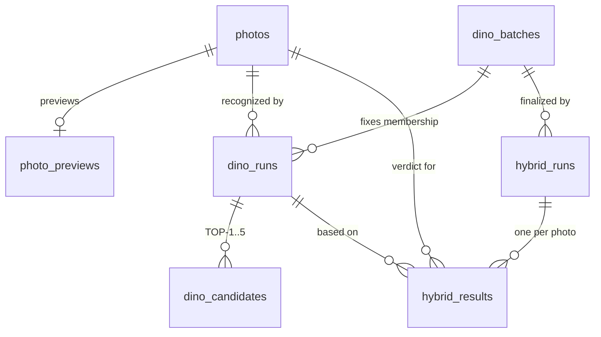

# Структура базы данных Scene Fingerprint / PhotoBAse

**Источник:** выведено из SQL-схем `schema/001_ingest.sql` … `schema/005_hybrid.sql` и из фактических чтений/записей в `app/ingest/database.py`, `app/preview/database.py`, `app/dino/database.py`, `app/hybrid/database.py`, а также из локальной SQLite-очереди `app/pipeline/queue.py`.

**Статус:** описание текущего контракта репозитория. На `photobase_ingest_test` подтверждены миграции 001–033 (030–033 применены в rollout 2026-10-16 после backup; повторный запуск — no-op).

**Важно про `111/chatgpt_md`:** архив описывает **другую, legacy-схему** (`dbname=photobase`, `user=lora`, широкая таблица `photos` с колонками `address/client/brand/category/qwen_status/...`). Она **не совпадает** с текущим контрактом и нормой не является. Ниже — только то, что реально читает/пишет текущий код.

## 1. Общая картина

Два независимых хранилища:

| Хранилище | Назначение | Где создаётся |
|---|---|---|
| PostgreSQL | физическая идентичность фото/видео, preview, DINO/HYBRID результаты | `schema/001…026.sql` |
| SQLite (`data/jobs.db`) | очередь заданий создания эталонных fingerprint-слепков | `app/pipeline/queue.py` |

PostgreSQL — источник истины для зарегистрированных фото и видео и для переходов photo-пайплайна DINO → HYBRID → PREVIEW. Видео хранится отдельно в `video_assets` и не участвует в этих photo-only стадиях. Слепки (FAISS-артефакты) живут на диске в `data/fingerprints/<id>`, а не в БД.

## 2. Порядок применения схем

Схемы применяются строго по порядку (внутренних зависимостей нет, но `004` опирается на таблицы из `003`):

```
001_ingest.sql   → photos
002_preview.sql  → photo_previews         (FK → photos)
003_dino.sql     → dino_runs, dino_candidates
004_dino_batches.sql → dino_batches, ALTER dino_runs ADD batch_id
005_hybrid.sql   → hybrid_runs, hybrid_results
006_job_queue.sql → job_queue
007_qwen.sql      → photo_qwen; ALTER job_queue ADD QWEN_PHOTO
008_settings.sql  → app_settings
009_collections.sql → collections, collection_members
010_users.sql     → users, sessions (seed: Администратор, Гость)
011_saved_searches.sql → saved_searches
012_automation.sql → automation_settings (сид: одна строка, enabled=FALSE)
013_nl_search.sql → ALTER job_queue: + job_type NL_SEARCH
014_search_indexes.sql → pg_trgm + GIN-индексы (filename, client/brand/category/description)
015_manager_selections.sql → manager_selections
016_client_aliases.sql → client_aliases
017_job_dedup.sql → индекс для дедупа активных QWEN-заданий
018_photo_metadata.sql → ALTER photos: + taken_at (EXIF), + size_bytes
019_job_ingest.sql → ALTER job_queue: + job_type INGEST_DIR (+ индекс дедупа)
020_job_media_search.sql → ALTER job_queue: + job_type MEDIA_SEARCH
021_job_cancel.sql → ALTER job_queue: + статус CANCELLED
022_address_directory.sql → address_directory, address_fingerprints
023_fingerprints.sql → fingerprints, fingerprint_versions
024_fingerprint_build.sql → ALTER job_queue: + FINGERPRINT_BUILD; fingerprint_versions.images_meta
025_job_progress.sql → job_queue.progress + PAUSED status
026_video_assets.sql → отдельный реестр durable source videos (`video_assets`)
027_video_playback_tickets.sql → short-lived HttpOnly playback/download tickets
028_video_transcodes.sql → video_derivatives + VIDEO_TRANSCODE job type + derivative download ticket link
029_photo_preview_jobs.sql → PHOTO_PREVIEW type + active per-photo dedup
030_video_trim.sql → trim operation metadata + VIDEO_TRIM/VIDEO_STORYBOARD job types and active dedup
031_pipeline_runs.sql → pipeline_runs / pipeline_run_stages (resumable supervisor) + single-active index
032_automation_defaults.sql → планировщик: авто-DINO/QWEN по умолчанию выключены + UPDATE существующей строки
033_visits_and_audit.sql → user_visits (посещения) + client_alias_audit (журнал правок алиасов)
```

**`004` теперь backfill-safe и идемпотентен (2026-10-12):** создаёт `dino_batches` при отсутствии, добавляет `dino_runs.batch_id` (nullable) при отсутствии, бэкфиллит существующие runs без batch (по одному legacy-batch на run, со статусом и счётчиками из run), затем ставит `NOT NULL` и создаёт индекс. Повторный прогон — no-op. Ранее файл делал `ADD COLUMN` и сразу `SET NOT NULL`, что падало на непустой `dino_runs`.

`026_video_assets.sql` — аддитивная миграция; на `photobase_ingest_test` записаны как применённые 026–032 (030–032 применены в rollout 2026-10-16 после backup, повторный запуск — no-op). Миграции 031 и 032 проверены в изолированной схеме (свежее применение, идемпотентность, откат) перед применением.

**Остальные файлы (001–003, 005) не идемпотентны:** `CREATE TABLE` без `IF NOT EXISTS`; повторный прогон на существующей БД упадёт. Для этого есть версионированный раннер `scripts/migrate.py`: он ведёт `public.schema_migrations` (version + sha256) и применяет каждый файл ровно один раз; повторный запуск — no-op, а изменение уже применённого файла обнаруживается как checksum-drift и останавливает работу. Существующая БД «усыновляется» командой `--baseline` (записи без выполнения). `db_bootstrap.sh` теперь применяет схему через этот раннер (для существующей БД — `--baseline`). `000_bootstrap.sql` раннером не применяется (это шаг суперпользователя).

**Repair для старых данных:** если по БД ранее работал старый `finish_batch` (до 2026-10-12) и могли остаться batch со статусом `DONE` при наличии `FAILED` runs, есть `scripts/repair_dino_batch_status.sql` (идемпотентный: переводит такие batch в `FAILED` и пересчитывает счётчики).

**Search path:** почти весь код пишет в `public.` явно (`app/ingest`, `app/dino`, `app/hybrid`). Исключение — `app/preview/database.py`, где таблица `photo_previews` указана **без схемы** (зависит от `search_path`). Косметическое, но стоит унифицировать.

## 3. ER-диаграмма



`video_assets` — отдельная source registry и не связана с фото-pipeline.

## 4. Таблицы

### 4.1 `photos` — физическая идентичность (INGEST)

Создаёт `schema/001_ingest.sql`; пишет только `app/ingest/database.py` (`insert_photos` / `insert_photo`), проверяет `check_identity_batch` (NEW/EXISTING/CONFLICT).

| Колонка | Тип | Ограничения |
|---|---|---|
| `photo_id` | TEXT | PRIMARY KEY |
| `source_path` | TEXT | NOT NULL |
| `filename` | TEXT | NOT NULL |
| `sha256` | CHAR(64) | NOT NULL UNIQUE |
| `container_format` | TEXT | NOT NULL (`JPEG`/`MPO`) |
| `frame_count` | INTEGER | NOT NULL |
| `width` | INTEGER | NOT NULL |
| `height` | INTEGER | NOT NULL |
| `created_at` | TIMESTAMP | NOT NULL DEFAULT CURRENT_TIMESTAMP |
| `taken_at` | TIMESTAMP | NULL — дата съёмки из EXIF (`018`) |
| `size_bytes` | BIGINT | NULL — размер исходного файла в байтах (`018`) |

`photo_id = PH_ + первые 24 hex SHA-256`. `sha256 UNIQUE` гарантирует одну строку на физический файл.

**`taken_at` / `size_bytes` (2026-10-14, `018_photo_metadata.sql`).** `taken_at` — `EXIF DateTimeOriginal` (fallback `DateTimeDigitized`) кадра 0; `NULL`, если тега нет. `size_bytes` — `stat()` исходника; используется для быстрого пропуска уже зарегистрированных файлов по паре (имя, размер) и для показа веса в интерфейсе. Обе колонки аддитивные; строки, зарегистрированные до `018`, остаются `NULL` до `scripts/backfill_photo_metadata.py` (скрипт только читает исходники). Фильтр грида по дате выбирает колонку: `date_mode=upload` → `created_at`, `date_mode=capture` → `taken_at`.

### 4.2 `photo_previews` — производные превью (PREVIEW)

Создаёт `schema/002_preview.sql`; пишет `app/preview/database.py:upsert_preview` (только когда оба превью валидны), читает `get_preview`.

| Колонка | Тип | Ограничения |
|---|---|---|
| `photo_id` | TEXT | PRIMARY KEY, FK → `photos(photo_id)` ON DELETE CASCADE |
| `small_path` | TEXT | NOT NULL |
| `middle_path` | TEXT | NOT NULL |
| `small_width` / `small_height` | INTEGER | NOT NULL |
| `middle_width` / `middle_height` | INTEGER | NOT NULL |
| `small_created_at` | TIMESTAMP | NOT NULL DEFAULT CURRENT_TIMESTAMP |
| `middle_created_at` | TIMESTAMP | NOT NULL DEFAULT CURRENT_TIMESTAMP |

Запись невозможна без зарегистрированного `photos`. `ON CONFLICT (photo_id) DO UPDATE` дополнительно переставляет `*_created_at = CURRENT_TIMESTAMP`.

### 4.3 `dino_runs` — один прогон DINO на одном фото

Создаёт `schema/003_dino.sql` (+ колонка `batch_id` из `004`); пишет `app/dino/database.py`.

| Колонка | Тип | Ограничения |
|---|---|---|
| `run_id` | BIGSERIAL | PRIMARY KEY |
| `photo_id` | TEXT | NOT NULL, FK → `photos` ON DELETE CASCADE |
| `batch_id` | BIGINT | NOT NULL, FK → `dino_batches(batch_id)` ON DELETE CASCADE (добавлена в `004`) |
| `run_type` | TEXT | NOT NULL, CHECK `NORMAL`/`FORCE_RERUN` |
| `status` | TEXT | NOT NULL, CHECK `PENDING`/`RUNNING`/`DONE`/`FAILED` |
| `dino_best_id` | TEXT | |
| `dino_score` | DOUBLE PRECISION | |
| `dino_second_score` | DOUBLE PRECISION | |
| `dino_margin` | DOUBLE PRECISION | |
| `dino_confidence` | TEXT | `HIGH`/`PROBABLE`/`AMBIGUOUS`/`NO_MATCH` |
| `dino_status` | TEXT | `CONFIDENT`/`PROBABLE_MATCH`/`AMBIGUOUS`/`NO_MATCH` |
| `started_at` / `finished_at` | TIMESTAMP | |
| `dino_time_sec` | DOUBLE PRECISION | длительность |
| `error_message` | TEXT | |
| `created_at` | TIMESTAMP | NOT NULL DEFAULT CURRENT_TIMESTAMP |

Индексы: `idx_dino_runs_photo(photo_id)`; `idx_dino_runs_photo_done(photo_id, finished_at DESC) WHERE status='DONE'`; `idx_dino_runs_batch(batch_id)`.

История сохраняется: один `photo_id` может иметь много runs (NORMAL + FORCE_RERUN). Предыдущие не удаляются.

### 4.4 `dino_candidates` — TOP-1..5 для одного run

Создаёт `schema/003_dino.sql`; пишет `save_success` в одной транзакции с обновлением run.

| Колонка | Тип | Ограничения |
|---|---|---|
| `run_id` | BIGINT | FK → `dino_runs(run_id)` ON DELETE CASCADE |
| `rank` | INTEGER | CHECK 1..5 |
| `fingerprint_id` | TEXT | NOT NULL |
| `score` | DOUBLE PRECISION | NOT NULL |
| `global_score` | DOUBLE PRECISION | NOT NULL |
| `environment_score` | DOUBLE PRECISION | NOT NULL |
| `color_score` | DOUBLE PRECISION | NOT NULL |
| `spatial_score` | DOUBLE PRECISION | NOT NULL |
| `best_image` | TEXT | |
| `best_image_score` | DOUBLE PRECISION | NOT NULL |

PRIMARY KEY `(run_id, rank)`; индекс `idx_dino_candidates_fingerprint(fingerprint_id)`.

### 4.5 `dino_batches` — фиксированный состав прогона

Создаёт `schema/004_dino_batches.sql`; пишет `app/dino/database.py` (`create_batch`, `start_batch`, `finish_batch`).

| Колонка | Тип | Ограничения |
|---|---|---|
| `batch_id` | BIGSERIAL | PRIMARY KEY |
| `run_type` | TEXT | NOT NULL, CHECK `NORMAL`/`FORCE_RERUN` |
| `status` | TEXT | NOT NULL, CHECK `PENDING`/`RUNNING`/`DONE`/`FAILED` |
| `total_count` | INTEGER | NOT NULL, CHECK ≥ 0 |
| `completed_count` | INTEGER | NOT NULL DEFAULT 0, CHECK ≥ 0 |
| `failed_count` | INTEGER | NOT NULL DEFAULT 0, CHECK ≥ 0 |
| `created_at` | TIMESTAMP | NOT NULL DEFAULT CURRENT_TIMESTAMP |
| `started_at` / `finished_at` | TIMESTAMP | |

Состав фиксируется созданием `dino_runs` со `status='PENDING'` на каждое фото. Пустой batch (`total_count=0`) сразу получает `status='DONE'`.

### 4.6 `hybrid_runs` — прогон HYBRID на одном DINO batch

Создаёт `schema/005_hybrid.sql`; пишет `app/hybrid/database.py` (`create_run`, требует `dino_batches.status='DONE'`).

| Колонка | Тип | Ограничения |
|---|---|---|
| `hybrid_run_id` | BIGSERIAL | PRIMARY KEY |
| `dino_batch_id` | BIGINT | NOT NULL, FK → `dino_batches` ON DELETE CASCADE |
| `status` | TEXT | NOT NULL, CHECK `PENDING`/`RUNNING`/`DONE`/`FAILED` |
| `total_count` | INTEGER | NOT NULL, CHECK ≥ 0 |
| `completed_count` | INTEGER | NOT NULL DEFAULT 0, CHECK ≥ 0 |
| `failed_count` | INTEGER | NOT NULL DEFAULT 0, CHECK ≥ 0 |
| `created_at` | TIMESTAMP | NOT NULL DEFAULT CURRENT_TIMESTAMP |
| `started_at` / `finished_at` | TIMESTAMP | |

Один DINO batch может иметь несколько HYBRID runs (повторный прогон = новая строка). Индекс `idx_hybrid_runs_dino_batch`.

### 4.7 `hybrid_results` — вердикт на одно фото

Создаёт `schema/005_hybrid.sql`; пишет `save_success`/`save_failure`.

| Колонка | Тип | Ограничения |
|---|---|---|
| `hybrid_run_id` | BIGINT | FK → `hybrid_runs` ON DELETE CASCADE |
| `photo_id` | TEXT | FK → `photos` ON DELETE CASCADE |
| `dino_run_id` | BIGINT | FK → `dino_runs` ON DELETE CASCADE |
| `hybrid_original_id` | TEXT | DINO-кандидат до HYBRID |
| `hybrid_final_id` | TEXT | итоговый кандидат |
| `hybrid_changed` | BOOLEAN | NOT NULL DEFAULT FALSE |
| `hybrid_old_score` / `hybrid_score` / `hybrid_margin` | DOUBLE PRECISION | |
| `hybrid_neighbors` | TEXT | JSON соседей |
| `status` | TEXT | NOT NULL, CHECK `DONE`/`FAILED` |
| `error_message` | TEXT | |
| `hybrid_time_sec` | DOUBLE PRECISION | |
| `created_at` | TIMESTAMP | NOT NULL DEFAULT CURRENT_TIMESTAMP |
| `finished_at` | TIMESTAMP | |

PRIMARY KEY `(hybrid_run_id, photo_id)`; индексы по `photo_id`, `dino_run_id`, `hybrid_final_id`. `save_*` дополнительно сверяет, что `dino_run_id` принадлежит batch'у этого run и имеет `status='DONE'`.

### 4.8 `job_queue` — отложенные задания обработки

Создаёт `schema/006_job_queue.sql`; пишет `app/jobs/database.py`, читает/исполняет `app/jobs/worker.py`. Введена вместе с web-API: API только ставит задание, тяжёлый inference выполняет отдельный worker-процесс.

| Колонка | Тип | Ограничения |
|---|---|---|
| `id` | BIGSERIAL | PRIMARY KEY |
| `job_type` | TEXT | NOT NULL, CHECK `DINO_BATCH`/`HYBRID_RUN`/`QWEN_PHOTO`/`NL_SEARCH`/`INGEST_DIR` |
| `payload` | JSONB | NOT NULL DEFAULT `{}` |
| `status` | TEXT | NOT NULL DEFAULT `PENDING`, CHECK `PENDING`/`RUNNING`/`DONE`/`FAILED` |
| `attempts` | INTEGER | NOT NULL DEFAULT 0, CHECK ≥ 0 |
| `result` | JSONB | |
| `error_message` | TEXT | |
| `created_at` | TIMESTAMP | NOT NULL DEFAULT CURRENT_TIMESTAMP |
| `started_at` / `finished_at` | TIMESTAMP | |

Индекс `idx_job_queue_status(status, id)`. Забор задания — `SELECT … FOR UPDATE SKIP LOCKED` + `UPDATE … status='RUNNING'` (атомарно). `payload` для `DINO_BATCH` = `{batch_id}`, для `HYBRID_RUN` = `{hybrid_run_id}`, для `QWEN_PHOTO` = `{photo_id}`.

### 4.8.1 Прогресс, пауза и батчи заданий (schema 025)

- `job_queue.progress` JSONB — `{done, total, stage, percent}`, пишет воркер во время длинных заданий (сборка слепка); окно рисует по нему прогресс-бар.
- Статус `PAUSED` — задание в очереди не забирается (`claim_next` берёт только `PENDING`), работающее замечает паузу между батчами и ждёт; ожидание ограничено `SCENE_PAUSE_MAX_SECONDS` (по умолчанию 300 с), иначе одна пауза блокировала бы однопоточную очередь.
- `claim_next(types=[...])` — выборка только нужных типов: так работает выделенный воркер сборки (`app.jobs.worker --only FINGERPRINT_BUILD --parallel N`).
- Батч: задания с общим `payload->>'batch_id'`; `GET /v1/fingerprints/batch/{id}` агрегирует их (проценты взвешены по числу фото).

### 4.9 `photo_qwen` — текстовые метаданные (QWEN)

Создаёт `schema/007_qwen.sql`; пишет `app/qwen` (через worker). Параллельный процесс, независимый от DINO/HYBRID; на идентичность и распознавание не влияет.

| Колонка | Тип | Ограничения |
|---|---|---|
| `photo_id` | TEXT | PRIMARY KEY, FK → `photos` ON DELETE CASCADE |
| `status` | TEXT | NOT NULL DEFAULT `PENDING`, CHECK `PENDING`/`RUNNING`/`DONE`/`FAILED` |
| `description` / `address` / `client` / `brand` / `category` | TEXT | |
| `tags` | JSONB | |
| `raw` | JSONB | полный ответ модели |
| `qwen_model` | TEXT | имя модели |
| `qwen_time_sec` | DOUBLE PRECISION | |
| `error_message` | TEXT | |
| `created_at` / `finished_at` | TIMESTAMP | |

Индексы по `status`, `address`, `client`. `007` также расширяет `job_queue.job_type` значением `QWEN_PHOTO`.

### 4.10 `app_settings` — настройки приложения (KV)

Создаёт `schema/008_settings.sql`; читает/пишет `app/settings_store.py`. Используется для выбора модели QWEN в рантайме (переопределяет env `QWEN_MODEL`).

| Колонка | Тип | Ограничения |
|---|---|---|
| `key` | TEXT | PRIMARY KEY |
| `value` | JSONB | NOT NULL |
| `updated_at` | TIMESTAMP | NOT NULL DEFAULT CURRENT_TIMESTAMP |

Ключ `qwen_model` хранит выбранную модель Ollama.

### 4.11 `collections` / `collection_members` — подборки/закладки

Создаёт `schema/009_collections.sql`; пишет `app/api/repository.py` (через API).

`collections`: `collection_id` BIGSERIAL PK, `user_id` TEXT (пока NULL — пользователей нет), `name` TEXT NOT NULL, `kind` CHECK `Моя`/`Клиентская`, `client` TEXT, `scope` CHECK `addresses`/`clients`/`photos`, `created_at`, `updated_at`.

`collection_members`: `collection_id` FK → `collections` ON DELETE CASCADE, `member_type` CHECK `address`/`client`/`photo`, `member_value` TEXT; PRIMARY KEY `(collection_id, member_type, member_value)`; индекс по `(member_type, member_value)`.

Аналог легаси `collections`/`collection_members`. `manager_selections` (состояние чекбоксов на менеджера) не перенесено — появится с пользователями.

### 4.12 `users` / `sessions` — пользователи и сессии

Создаёт `schema/010_users.sql`; логика — `app/users/` (security + database), вход — `POST /v1/auth/login`.

`users`: `user_id` BIGSERIAL PK, `name` TEXT UNIQUE, `color` TEXT, `role` CHECK `Администратор`/`Менеджер`/`Гость`, `active` BOOLEAN, `password_hash` TEXT (scrypt, `NULL` = без пароля), `created_at`. Сид: `Администратор`, `Гость`.

`sessions`: `session_id` TEXT PK (opaque), `user_id` FK → `users` ON DELETE CASCADE, `created_at`, `expires_at`. Индекс по `user_id`.

Пароли — `scrypt$<salt>$<hash>` (stdlib `hashlib.scrypt`), сверка `hmac.compare_digest`. Open-text сравнение из легаси не повторяется. Роли → scopes: Администратор `*`, Менеджер `read, collections:write, searches:write, upload:write, jobs:read, jobs:write, addresses:write, videos:read, videos:write, videos:download`, Гость `read`. Полная матрица и правила — в [`auth_roles.md`](auth_roles.md).

### 4.13 `saved_searches` — сохранённые поиски

Создаёт `schema/011_saved_searches.sql`; пишет `app/api/repository.py` (через API `/v1/searches`).

`saved_searches`: `search_id` BIGSERIAL PK, `user_id` TEXT (NULL, пока не привязано к сессии), `name` TEXT NOT NULL, `filters` JSONB (снимок фильтров GRID: `q`, `addresses[]`, `clients[]`, `date_from`, `date_to`, `collection_id`), `created_at`; индекс по `user_id`.

Аналог легаси `search`/«История поиска». Не влияет на пайплайны — только восстанавливает набор фильтров в UI.

### 4.14 `automation_settings` — планировщик

Создаёт `schema/012_automation.sql`; логика — `app/jobs/automation.py`, API `/v1/automation`, цикл — `python -m app.jobs.worker --automation`.

Одна строка `id = 1`: `enabled` BOOLEAN (по умолчанию FALSE), `interval_minutes` INT (1..10080), `auto_dino` BOOLEAN, `auto_qwen` BOOLEAN, `last_tick` TIMESTAMP, `updated_at`. Планировщик только **ставит в очередь** уже существующие операции (NORMAL DINO batch для фото без прогонов, QWEN для фото без `photo_qwen`); новые файлы не импортирует и данные не удаляет. Watcher-режим легаси не реализован намеренно.

### 4.15 NL-поиск — типы заданий

`schema/013_nl_search.sql` расширяет `job_queue.job_type` значением `NL_SEARCH` (идемпотентно, через DROP/ADD CHECK). Само NL-задание не пишет таблиц: worker переводит запрос в фильтры локальным QWEN и выполняет обычный поиск, результат кладётся в `job_queue.result` (JSONB). Инференс — только в воркере (`app/api/nl_search.py`).

`schema/019_job_ingest.sql` добавляет `INGEST_DIR` — обход рабочей папки. Задание кладёт `app/api/routes.py` (`POST /v1/ingest/run`), выполняет воркер через `app/ingest/runner.py:ingest_directory`, результат (`counters`, `registered`, `existing`, `conflicts`) — в `job_queue.result`. Активное задание на ту же папку не дублируется (индекс `idx_job_queue_ingest_active_dir`). Хеширование и декодирование никогда не выполняются в обработчике запроса.

### 4.16 Индексы поиска — `pg_trgm` + GIN

`schema/014_search_indexes.sql` (идемпотентно) создаёт триграммные GIN-индексы (`gin_trgm_ops`) по `photos.filename` и `photo_qwen.client/brand/category/description`. Расширение `pg_trgm` ставится в `000_bootstrap.sql` (trusted-расширение — владелец БД может создать сам; в минимальных сборках отсутствие расширения не ломает bootstrap — 014 лишь пишет NOTICE).

`repository.list_photos` для `q` переписан как `photo_id IN (SELECT filename ... UNION SELECT client/brand/category/description ...) OR address ILIKE`, чтобы OR по одной таблице превращался в `BitmapOr` по индексам (OR по двум таблицам планировщик в индексы не пускает). На малых объёмах планировщик по-прежнему может выбрать seq scan — это корректно; индексы дают эффект при росте данных.

### 4.17 `manager_selections` — персональное состояние менеджера

`schema/015_manager_selections.sql` (идемпотентно): `user_id` TEXT PK, `state` JSONB, `updated_at`. Аналог легаси `manager_selections`: хранит снимок состояния GRID на пользователя (выбранные `photo_id`). API `GET/PUT /v1/selection` требует аутентифицированного пользователя (`_require_user`), запись идёт только в строку текущего `user_id` (scope `collections:write`). В открытом режиме без сессии — 401.

### 4.18 Надёжность воркеров (recovery, claim, дедуп)

- **Recovery доменных строк.** `POST /v1/jobs/requeue-stale` и `python -m app.jobs.worker --requeue-stale MINUTES` теперь восстанавливают не только `job_queue`, но и зависшие `dino_runs` (`app/dino/database.py:requeue_stale_runs`) и `hybrid_runs` (`app/hybrid/database.py:requeue_stale_runs`) — RUNNING старше порога возвращается в PENDING; завершённые результаты не трогаются.
- **Атомарный claim HYBRID.** Runner принимает только `PENDING` и делает атомарный `UPDATE ... WHERE status='PENDING'` (через `start_run`); повторный/параллельный запуск того же run отклоняется. При повторном прогоне уже завершённые фото пропускаются (`completed_photo_ids`).
- **Идемпотентные результаты.** `dino_candidates` и `hybrid_results` пишутся с `ON CONFLICT ... DO UPDATE`, поэтому восстановленный run не падает на дублях.
- **Дедуп планировщика.** `automation.run_tick` сериализован advisory-lock'ом (`pg_try_advisory_lock`) и не создаёт новый DINO batch, если уже есть PENDING/RUNNING (`dino_db.has_active_batch`).
- **Дедуп QWEN-заданий.** `jobs_db.enqueue_qwen` вставляет задание только при отсутствии активного (PENDING/RUNNING) задания для того же `photo_id` (одним statement); индекс `idx_job_queue_qwen_active_photo` (schema 017) держит проверку дешёвой. Роут `/v1/jobs/qwen` возвращает `skipped`.

### 4.19 Пул соединений и bounded futures (2026-10-13)

- **Пул соединений.** `app/ingest/database.py:get_connection()` теперь отдаёт подключение из общего `psycopg_pool.ConnectionPool` (те же commit/rollback-семантики, что и `psycopg.connect`). Управление: `SCENE_DB_POOL` (по умолчанию `1`), `SCENE_DB_POOL_MIN` (1), `SCENE_DB_POOL_MAX` (10). DINO/PREVIEW/HYBRID используют тот же аксессор.
  - **Fork-безопасность.** INGEST/PREVIEW форкают процессы через `ProcessPoolExecutor`; в ребёнке пул **отключается** (`os.register_at_fork`), а унаследованные соединения не собираются GC (иначе закрытие отправило бы Terminate в сокет родителя).
  - **Замер (локально, 20 запросов, медиана):** `/v1/photos?limit=50` 20.63 → **2.42 мс**, `/v1/clients` 18.68 → **2.04 мс**, `/v1/qwen/stats` 34.42 → **1.06 мс**. Под нагрузкой 64 параллельных запроса при `max_size=10` — все 200, без PoolTimeout.
  - Ограничение: с пулом нельзя рассчитывать на `CREATE TEMP TABLE` между вызовами `get_connection()` (соединение может отличаться).
- **Bounded futures.** `app/core/parallel.py:bounded_submit()` ограничивает число одновременных futures (окно ≈ 2×workers) в INGEST, PREVIEW, DINO и HYBRID — вместо создания future на каждый элемент сразу (важно для больших импортов).

### 4.20 `client_aliases` — нормализация клиентов QWEN

`schema/016_client_aliases.sql` (идемпотентно): `alias` TEXT PK, `canonical` TEXT, `created_at`. Аналог легаси `client_aliases`/`client_normalizer`: сопоставляет «сырое» написание клиента от QWEN каноническому. Исходные строки в `photo_qwen` не меняются. `list_clients` группирует по `COALESCE(alias.canonical, client)`; фильтр `client=` в `/v1/photos` тоже учитывает алиасы. API `GET /v1/client-aliases`, `PUT/DELETE /v1/client-aliases` (scope `collections:write`).

### 4.21 `address_directory` / `address_fingerprints` — справочник адресов

`schema/022_address_directory.sql` (идемпотентно; аддитивно, ничего не переписывает).

- `address_directory`: `address_id` SERIAL PK, `legal_address` (полное юридическое название), `simple_address` (упрощённое — для чекбоксов и списков), `active`, `sort_order`, `created_at`, `updated_at`. CHECK `address_directory_named` требует заполнить хотя бы одно из двух названий; частичный UNIQUE-индекс `uq_address_directory_legal` запрещает два адреса с одинаковым юридическим названием (сравнение без учёта регистра и пробелов, пустые значения не считаются).
- `address_fingerprints`: `fingerprint_id` TEXT **PK**, `address_id` → `address_directory` (`ON DELETE CASCADE`), `active`, метки времени. В легаси у этой таблицы не было ни PK, ни уникальности — здесь один идентификатор принадлежит ровно одному адресу, поэтому опечатка не создаёт конкурирующих строк.
- **Связь с выдачей.** Распознанный идентификатор не хранится в `photos` — он вычисляется (`hybrid_final_id`, иначе `dino_best_id`). Поэтому `app/api/repository.py` разрешает его в имена во внешнем запросе: базовый SELECT считает `address`, а внешний слой делает `LEFT JOIN address_fingerprints` по этому значению и `LEFT JOIN address_directory`. Фото без сопоставления читается с `NULL` в обоих полях; ничего не переписывается.
- **Импорт адресов**: `POST /v1/addresses/import` (multipart, `.xlsx/.xlsm/.csv/.tsv`, scope `addresses:write`) — разбор в `app/api/directory.py:parse_address_table` (openpyxl для XLSX, «умные» заголовки или первые две колонки) и `import_addresses` (идемпотентно: существующий адрес находится по юридическому названию и сохраняет id, обновляется только упрощённое имя).
- **Привязка слепка к адресу**: `PUT /v1/fingerprints/registry/{id}/address` `{address_id}` (scope `addresses:write`) — ставит или снимает соответствие в `address_fingerprints`.
- **API**: `GET /v1/addresses/directory` (scope `read`) — список адресов с их идентификаторами; `GET /v1/addresses/unassigned` — идентификаторы из `data/fingerprints/`, которым ещё не сопоставлен адрес; `POST/PUT/DELETE /v1/addresses/directory[/{id}]` и `PUT /v1/addresses/directory/{id}/fingerprints` (scope `addresses:write`). Модуль — `app/api/directory.py`; запросы параметризованы, идентификатор сверяется с `^[A-Za-z0-9._-]{1,64}$`, `sort_order` ограничен.
- **Откат**: `DROP TABLE address_fingerprints; DROP TABLE address_directory;`

### 4.22 `fingerprints` / `fingerprint_versions` — реестр слепков

`schema/023_fingerprints.sql` (идемпотентно; аддитивно, векторы не трогаются).

- `fingerprints`: `fingerprint_id` TEXT PK (технический id, `78_v33`), `display_name`, `description`, `algorithm_version` (из `metadata.json.version`), `model`, `dimension`, `images_count`, `source_folder` (папка эталонных фото, заполняется вручную), `active` (архив), метки времени. CHECK `images_count >= 0`.
- `fingerprint_versions`: журнал пересборок — `version_id` SERIAL PK, `fingerprint_id` → `fingerprints` (`ON DELETE CASCADE`), `algorithm_version`, `images_count`, `image_names` JSONB (имена использованных файлов), `source_folder`, `is_current`, `created_at`, `recreated_at`. Частичный UNIQUE-индекс `uq_fingerprint_versions_current` гарантирует **ровно одну текущую версию** на слепок.
- **Источник истины — диск.** `app/api/fingerprints.py` читает `data/fingerprints/<id>/metadata.json` (`sync_from_disk()`), заводит строку реестра и добавляет версию **только когда изменилось число фото или список имён** — повторная синхронизация ничего не пишет. Реестр можно пересобрать с диска в любой момент; человеческие поля (имя, описание, папка, архив) живут только в базе.
- **API**: `GET /v1/fingerprints/registry` (scope `read`) — список с адресом (из `address_fingerprints`) и текущей версией; `GET /v1/fingerprints/registry/{id}` и `.../versions` (scope `read`); `POST /v1/fingerprints/sync` и `PUT /v1/fingerprints/registry/{id}` (scope `jobs:write`, то есть Администратор).
- **UI**: вкладка «Слепки» в техразделе — синхронизация с диском, переименование/описание/папка-источник, архивация тумблером, журнал версий с именами файлов.
- **Сборка из окна** (`schema/024`): тип задания `FINGERPRINT_BUILD` в `job_queue` (выполняет scene-worker, как `INGEST_DIR`); `fingerprint_versions.images_meta` хранит `[{name, taken_at}]` — имена и **даты съёмок** использованных фото, потому что оригиналы после сборки не сохраняются. `fingerprints.source_folder` заполняется из `metadata.json` только если пуст (ручная правка в окне приоритетнее). Бэкфилл для слепков старого формата: `scripts/backfill_fingerprint_meta.py`.
- **Откат**: `DROP TABLE fingerprint_versions; DROP TABLE fingerprints;` (теряется только человеческая обвязка).

### 4.23 `video_assets` — identity durable source video

Создаёт `schema/026_video_assets.sql`; записывает только video-specific INGEST (`app/ingest/video_register.py`). Таблица намеренно не связана с `photos`, `photo_previews`, `dino_runs`, `hybrid_results` или `photo_qwen`.

| Колонка | Тип | Ограничения |
|---|---|---|
| `video_id` | TEXT | PK, `VI_` + первые 24 hex SHA-256 |
| `source_path`, `filename` | TEXT | NOT NULL; источник только читается |
| `sha256` | CHAR(64) | NOT NULL UNIQUE; полный физический файл |
| `container_format`, `video_codec` | TEXT | NOT NULL, метаданные ffprobe |
| `width`, `height` | INTEGER | NOT NULL, > 0 |
| `duration_seconds` | DOUBLE PRECISION | NOT NULL, > 0 |
| `fps` | DOUBLE PRECISION | NULL если не удалось определить |
| `frame_count` | BIGINT | NULL если не сообщён/не выведен из fps |
| `size_bytes` | BIGINT | NOT NULL, > 0 |
| `taken_at` | TIMESTAMPTZ | NULL, creation_time из metadata без догадки |
| `created_at` | TIMESTAMPTZ | NOT NULL DEFAULT CURRENT_TIMESTAMP (время регистрации) |
| `display_title` | TEXT | NOT NULL DEFAULT ''; пользовательское имя для UI, максимум 300 знаков |

`video_playback_tickets` (`schema/027`, расширяется `028`) хранит только SHA-256 короткоживущего HttpOnly cookie, `video_id`, тип действия, optional derivative id и expiry (5 минут). Это даёт HTML `<video>`/Range download доступ без bearer-токена в URL и без полного чтения ролика в память.

`video_derivatives` (`schema/028_video_transcodes.sql`, расширяется `030_video_trim.sql`) хранит profile/source hash, operation key, статус/job, output path/hash/metadata, encoder и ошибки. Profile derivatives: `strong_720p`, `standard_1080p`, `light_1440p`; trim derivatives используют `profile='trim'`, `operation_kind='TRIM'`, `start_seconds/end_seconds`. Уникальность по `(video_id,source_sha256,operation_key)` позволяет несколько диапазонов и сохраняет существующие compression rows.

`VIDEO_TRIM` и `VIDEO_STORYBOARD` (`030`) — отдельные фоновые jobs в выделенном video-worker; `VIDEO_STORYBOARD` создаёт 8 bounded JPEG frames keyed by source hash под отдельным managed preview root. Файлы не относятся к originals и не публикуются до полной проверки. Новая 030 migration пока pending; в `photobase_ingest_test` подтверждены 001–029.

Путь, контейнер и MIME не приходят от клиента API для download: source берётся по зарегистрированному `video_id`, derivative — по базе и проверенному derivatives root, после чего применяется path confinement.

## 5. Локальная SQLite-очередь (не PostgreSQL)

`app/pipeline/queue.py` создаёт `data/jobs.db`, таблица `jobs`:

| Колонка | Тип | Ограничения |
|---|---|---|
| `id` | INTEGER | PRIMARY KEY AUTOINCREMENT |
| `source_folder` | TEXT | NOT NULL |
| `fingerprint_id` | TEXT | NOT NULL |
| `status` | TEXT | NOT NULL DEFAULT `PENDING` (`PENDING`/`PROCESSING`/`DONE`/`FAILED`) |
| `priority` | INTEGER | NOT NULL DEFAULT 0 |
| `attempts` | INTEGER | NOT NULL DEFAULT 0 |
| `created_at` | TEXT | NOT NULL |
| `started_at` / `finished_at` | TEXT | |
| `error` | TEXT | |

Индекс `idx_jobs_status_priority(status, priority DESC, id)`. Забор задания — `BEGIN IMMEDIATE` + `UPDATE … WHERE status='PENDING'` (атомарный claim). Это отдельный от PostgreSQL процесс создания слепков.

## 6. Подключение (env)

Все четыре PostgreSQL-модуля используют один набор переменных:

```
INGEST_DB_HOST      (default localhost)
INGEST_DB_PORT      (default 5432)
INGEST_DB_NAME      (default photobase_ingest_test)
INGEST_DB_USER      (default lora_ingest)
INGEST_DB_PASSWORD  (обязательна; отсутствие → ошибка)
```

Расхождение с архивом: legacy-проект использовал `dbname=photobase`, `user=lora` (и пустой пароль). Текущий код по умолчанию ждёт `photobase_ingest_test` / `lora_ingest` — эти имена подтверждены `docs/ingest.md` §5.

Статус на 2026-10-12: БД `photobase_ingest_test` и роль `lora_ingest` созданы в локальном кластере, применены `schema/001–005` (7 таблиц). Ранее в кластере их не было (были только `albion`, `postgres`, `template*`), то есть проверка из `docs/ingest.md` §5 относилась к более раннему состоянию/окружению. Процедура развёртывания — в [`db_setup.md`](db_setup.md).

## 7. Замечания и расхождения (кандидаты на исправление)

1. ~~**`finish_batch`** ставит `DONE` при наличии `FAILED`~~ **— исправлено (2026-10-12)**: `finish_batch` теперь возвращает `FAILED`, если есть провалы, а `hybrid.database.create_run` дополнительно требует `failed_count == 0`. Покрыто интеграционными тестами (`tests/test_dino_batch_integration.py`).
2. **Миграция `004`**: `SET NOT NULL` без backfill → падение на непустой `dino_runs`.
3. **`photo_previews` без `public.`** в `app/preview/database.py` — единственная не-квалифицированная таблица.
4. **Нет `updated_at`/heartbeat** ни в `dino_runs`, ни в `dino_batches` — нельзя отличить «долго работающий» run от «зависшего».
5. **Схемы не идемпотентны**, миграционного раннера нет: повторное применение падает.
6. `dino_candidates.rank` ограничен 1..5 и код режет `candidates[:5]` — соответствие сохраняется, но лимит зашит в двух местах.

## 8. Связанные материалы

- [`ingest.md`](ingest.md), [`preview.txt`](preview.txt), [`dino.txt`](dino.txt), [`hybrid.txt`](hybrid.txt) — поведение слоёв.
- [`project_assessment.md`](project_assessment.md) — риски и план.
